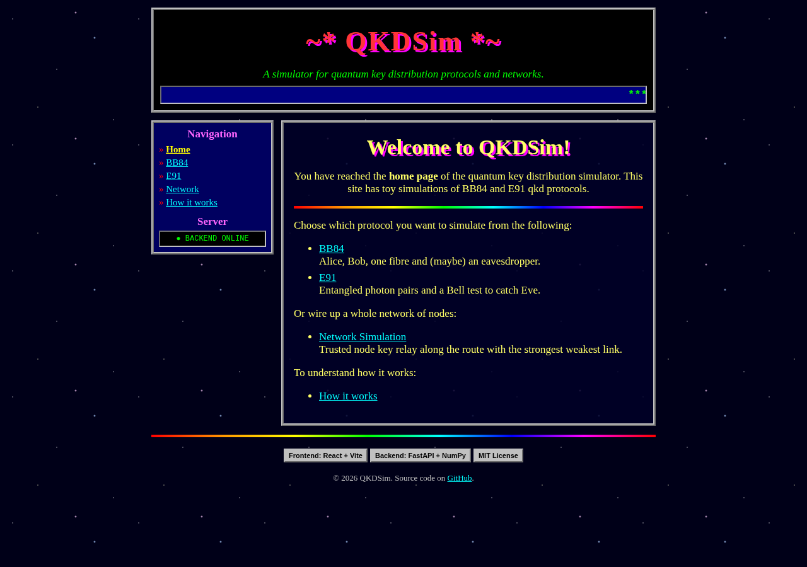

# Quantum Communication Networks

[](LICENSE)
[](https://www.python.org/)
[](https://fastapi.tiangolo.com/)
[](https://react.dev/)
[](https://tangy-cheese.github.io/qkd_sim/)

Website which displays how various quantum communication protocols can interact.

**Live demo: https://tangy-cheese.github.io/qkd_sim/**

> The backend runs on a free server that sleeps when idle, so the first request can take up to a minute to wake it.



## What is this?

QKDSim is a simulator for quantum key distribution (QKD): ways for two parties to agree on a secret key using single photons, such that anyone listening in on the line disturbs the photons and gives themselves away.

### What you can do

- **BB84 over a single fibre.** Choose the number of qubits Alice sends, the fibre length and its attenuation, and optionally put an eavesdropper (Eve) on the line. The simulation models photon loss, detector dark counts, basis sifting, error correction and privacy amplification, and reports the qubit error rate (QBER), the secure key rate and the final secure key. If the error rate is too high for any secure key to be left, the run is aborted.
- **E91 over a single fibre.** A source next to Alice makes entangled photon pairs and sends one photon of each pair down the fibre to Bob. Both measure at random polariser angles. Pairs with matching angles become the key, and a CHSH Bell test on four other angle combinations checks the photons were still entangled. Without Eve the Bell value is S ≈ 2√2 ≈ 2.83. Eve measuring the photons breaks the entanglement, S drops to 2 or below and the run is aborted.
- **Networks of trusted nodes.** Build a network of nodes joined by fibre links, each with its own length, attenuation and optional eavesdropper. A route's key rate is only as good as its worst link, so the simulator uses a modified Dijkstra's algorithm to find the route between a sender and a receiver whose worst link has the lowest loss (total loss breaks ties). It runs BB84 over every link on that route and relays the key hop by hop, XOR-encrypting it with each link's key. The route is drawn on a map with the error rate of each link.

- Results are random, so two runs with the same settings give slightly different numbers.

## Development Setup

```bash
git clone https://github.com/Tangy-Cheese/qkd_sim.git
cd qkd_sim/

# Create a python virtual environment
python -m venv .venv

# MacOS/Linux
source .venv/bin/activate

# Windows
.venv\Scripts\activate

# Install package dependencies
pip install -e "./backend[test]"
```

`-e` installs in editable mode, linking to `backend/src/` so source changes reflect immediately. `[test]` pulls project dependencies plus pytest.

### Tests

```bash
cd backend
pytest
```

## Backend (FastAPI)

### Requirements

```bash
pip install fastapi uvicorn
```

### Running

From project root:

```bash
cd backend/src
python -m uvicorn main:app --reload
```

Server is up when you see `uvicorn running on http://127.0.0.1:8000`.

Interactive API docs: `http://localhost:8000/docs`

> [!IMPORTANT]
> To stop the server, use `Ctrl + C` in the same terminal. Do not close the terminal window.

## Frontend (React)

### Requirements

- Node.js >= 22
- npm (or pnpm / yarn)

### Running

```bash
cd frontend
npm ci
npm run dev
```

Open `http://localhost:5173`. Start the backend first: the frontend sends its requests to `/api`, which the Vite dev server forwards to `http://127.0.0.1:8000`. The sidebar shows whether the backend is reachable.

To use a backend running somewhere else, set `VITE_API_URL` (e.g. `VITE_API_URL=http://localhost:9000 npm run dev`) and add the frontend's address to `allow_origins` in `backend/src/main.py`.
